# Introduction

Dans le cadre de ma formation [À compléter — filière et établissement], j'ai effectué un stage au sein de
[À compléter — organisme d'accueil], durant une période de [À compléter — durée]. Ce stage s'est déroulé
sous la supervision de [À compléter — encadrant], avec pour objectif de concevoir et de réaliser une
application web complète, de l'analyse des besoins jusqu'au déploiement.

Les petites et moyennes entreprises marocaines — agences, cabinets, entreprises de services ou de travaux —
mènent chaque mois plusieurs projets en parallèle : un déménagement de bureaux, la refonte d'un site web, le
lancement d'une application, un stand de salon professionnel. Pour chacun, il faut suivre un budget en dirhams,
des dépenses et leurs justificatifs, des tâches et des échéances, du matériel stocké dans un ou plusieurs
entrepôts, et des déplacements dont le coût dépend du prix du carburant. Dans la pratique, ces informations
sont dispersées entre des tableurs, des messageries et des documents partagés.

C'est dans ce contexte que j'ai eu pour mission de concevoir et de développer **Business Project
Assistance**, une application web qui centralise la gestion des projets, des budgets, des dépenses, du stock et
des déplacements d'une organisation, et qui l'accompagne d'un assistant d'intelligence artificielle capable de
répondre aux questions sur ces données, de faire des calculs exacts et de préparer des brouillons — sans
jamais modifier les données sans l'accord de l'utilisateur. Ce rapport présente le fonctionnement de cette
application ainsi que la démarche suivie pour la réaliser.

# Résumé / Abstract

## English version

This project presents the design and development of **Business Project Assistance**, a web application that
helps small and medium-sized businesses in Morocco run their projects: budgets in Moroccan dirhams, expenses
with attached receipts, tasks and milestones, stock spread across warehouses, and business trips with fuel
cost estimates. The backend is a Flask REST API (Python, SQLAlchemy, PostgreSQL) and the frontend a React and
TypeScript single-page application styled with Tailwind CSS and shadcn/ui.

Every organization has four roles — Owner, Project manager, Contributor and Viewer — checked on every API
route, and every figure (actual spend, remaining budget, variance, percentage consumed, spend rate) is computed
by one deterministic metrics service with decimal arithmetic. An AI assistant (Gemini or Groq) answers
questions about the organization's data through 17 server-side tools: it never invents a number, performs all
arithmetic through a calculator tool, and can only draft new projects or stock changes, which the user reviews
and confirms. The interface is fully available in English, French and Arabic (right-to-left), in light and dark
mode.

The application is covered by 364 automated backend tests, an end-to-end browser test of 15 steps and an
11-question evaluation of the assistant against known answers, and is packaged with Docker Compose for
deployment.

## Version française

Ce projet présente la conception et le développement de **Business Project Assistance**, une application web
qui aide les petites et moyennes entreprises marocaines à piloter leurs projets : budgets en dirhams, dépenses
accompagnées de justificatifs, tâches et jalons, stock réparti entre plusieurs entrepôts, et déplacements
professionnels avec estimation du coût du carburant. Le serveur est une API REST Flask (Python, SQLAlchemy,
PostgreSQL) et l'interface une application monopage React et TypeScript, stylée avec Tailwind CSS et shadcn/ui.

Chaque organisation dispose de quatre rôles — Propriétaire, Chef de projet, Contributeur et Lecteur — vérifiés
sur chaque route de l'API, et chaque chiffre (dépenses réelles, budget restant, écart, pourcentage consommé,
rythme de dépense) est calculé par un unique service de métriques, en arithmétique décimale. Un assistant d'IA
(Gemini ou Groq) répond aux questions sur les données de l'organisation à l'aide de 17 outils côté serveur : il
n'invente jamais de chiffre, effectue tous ses calculs par un outil de calcul, et ne peut que préparer des
brouillons de projet ou de mouvements de stock, que l'utilisateur vérifie puis confirme. L'interface est
entièrement disponible en anglais, en français et en arabe (de droite à gauche), en mode clair et sombre.

L'application est couverte par 364 tests automatisés côté serveur, un test de bout en bout de 15 étapes dans
un navigateur et une évaluation de l'assistant sur 11 questions à réponse connue ; elle est conditionnée avec
Docker Compose pour le déploiement.

# Introduction générale

## Contexte du projet

La gestion de projet dans une petite structure repose encore très souvent sur des outils génériques : un
tableur par projet pour le budget, un groupe de messagerie pour les tâches, une photo de ticket envoyée par
téléphone en guise de justificatif, un carnet ou un second tableur pour le stock. Ces outils sont gratuits et
connus de tous, mais ils ne se parlent pas : le budget « consommé » d'un projet doit être recalculé à la main,
personne ne sait exactement quel matériel se trouve dans quel entrepôt, et le coût d'un déplacement est estimé
au jugé.

Les logiciels de gestion de projet du marché couvrent généralement les tâches, mais rarement le budget en
dirhams, les justificatifs, le stock et les déplacements dans un même outil, et ils sont pensés pour de
grandes équipes et en anglais. Par ailleurs, les assistants d'IA généralistes savent rédiger, mais inventent
volontiers des chiffres : ils ne peuvent pas servir tels quels à répondre à « combien reste-t-il sur le budget
du déménagement ? ».

## Présentation du sujet

Le sujet consiste à concevoir et développer une application web, **Business Project Assistance**, qui réunit
au sein d'une même plateforme :

- les **projets** d'une organisation, avec leur budget, leurs jalons, leurs tâches et leur historique
  d'activité ;
- les **dépenses** et leurs **justificatifs** (factures, reçus), avec des indicateurs budgétaires calculés de
  façon exacte et un rapport par projet ;
- le **stock**, propre à chaque projet ou commun à l'organisation (« stock général »), réparti entre des
  **entrepôts** localisés sur une carte ;
- les **déplacements** professionnels, avec leur itinéraire et une estimation du coût du carburant à partir
  des prix moyens à la pompe au Maroc ;
- un **assistant d'IA** qui lit ces données, calcule, explique et prépare des brouillons, sous le contrôle de
  l'utilisateur.

## Problématique

La question à laquelle ce projet répond peut se formuler ainsi : **comment donner à une petite organisation
une vision fiable et partagée de ses projets — budget, dépenses, stock et déplacements — tout en lui offrant
l'aide d'un assistant d'IA sans risquer de chiffres inventés ni de modifications non voulues ?**

Elle se décline en plusieurs problèmes concrets :

- aucun contrôle d'accès : toute personne ayant le fichier peut le lire ou le modifier ;
- des indicateurs budgétaires recalculés à la main, donc sujets à erreur et différents d'une personne à
  l'autre ;
- aucune traçabilité des modifications ni des justificatifs ;
- un stock sans historique, sans localisation et sans alerte de réapprovisionnement ;
- des coûts de déplacement estimés sans méthode ;
- des assistants d'IA qui ne connaissent pas les données de l'entreprise, ou qui les inventent.

## Objectifs du projet

### Objectif général

Concevoir et développer une application web sécurisée, multilingue et responsive, permettant à une
organisation de gérer ses projets, ses budgets, ses dépenses, son stock et ses déplacements, avec un
assistant d'IA fiable qui s'appuie exclusivement sur des chiffres calculés par le serveur.

### Objectifs spécifiques

- Mettre en place des organisations avec quatre rôles (Propriétaire, Chef de projet, Contributeur, Lecteur)
  et des invitations par lien.
- Gérer les projets, leurs jalons, leurs tâches, leurs dépenses et leurs justificatifs, avec un journal
  d'activité.
- Calculer de façon déterministe et documentée les indicateurs budgétaires, et produire un rapport par projet.
- Gérer un stock par projet et un stock général, réparti entre des entrepôts, avec un historique complet des
  mouvements.
- Planifier des déplacements et en estimer le coût de carburant à partir d'un itinéraire et de prix à jour.
- Intégrer un assistant d'IA à outils, qui répond, calcule et prépare des brouillons confirmés par
  l'utilisateur.
- Proposer une interface en anglais, en français et en arabe, en modes clair et sombre.
- Garantir la qualité par des tests automatisés et faciliter le déploiement avec Docker.

## Annonce du plan du rapport

Ce rapport est structuré en cinq chapitres :

- **Chapitre 1** : Cadre du projet et étude de l'existant ;
- **Chapitre 2** : Analyse et spécification des besoins ;
- **Chapitre 3** : Conception de la solution ;
- **Chapitre 4** : Réalisation et mise en œuvre ;
- **Chapitre 5** : Aperçu technique approfondi (bilingue anglais / français).

# Chapitre 1 : Cadre du projet et étude de l'existant

## Présentation de l'organisme d'accueil

### Secteur d'activité

[À compléter — secteur d'activité de l'organisme d'accueil]

### Service d'accueil

[À compléter — service ou département au sein duquel le projet a été réalisé]

## Étude de l'existant

Les petites organisations ciblées gèrent aujourd'hui leurs projets avec un assemblage d'outils génériques :

- **des tableurs** (un par projet ou un classeur partagé) pour le budget et la liste des dépenses ;
- **des messageries** pour répartir les tâches et envoyer les photos de factures ;
- **des documents partagés** pour les plannings et les comptes rendus ;
- **un inventaire papier ou un second tableur** pour le matériel, souvent sans distinction d'entrepôt ;
- **des estimations au jugé** pour le coût des déplacements, sans référence au prix réel du carburant.

## Critique de l'existant

Cette organisation présente plusieurs limites :

- **Contrôle d'accès inexistant** : tout destinataire du fichier peut lire et modifier toutes les données, y
  compris celles d'autres projets.
- **Indicateurs incohérents** : chaque personne recalcule le « consommé » ou le « reste à dépenser » à sa
  manière ; une dépense annulée reste parfois comptée.
- **Aucune traçabilité** : on ne sait pas qui a modifié un montant, ni quand ; les justificatifs se perdent
  dans les conversations.
- **Stock opaque** : pas d'historique des entrées et sorties, pas de localisation, pas d'alerte quand un article
  passe sous son seuil.
- **Coûts de déplacement approximatifs** : aucune méthode commune ni prise en compte des variations du prix à
  la pompe.
- **Langue** : les outils du marché sont surtout en anglais, alors que les équipes travaillent en français et en
  arabe.

## Solution proposée

Face à ces limites, nous proposons une application web reposant sur une base de données relationnelle
centralisée, une API REST qui applique les règles d'accès et les règles métier, et une interface moderne et
multilingue. Les calculs ne sont faits qu'à un seul endroit, côté serveur, et l'assistant d'IA s'appuie sur ces
mêmes calculs.

| Critère | Solution existante | Application proposée |
| --- | --- | --- |
| Contrôle d'accès | Aucun | 4 rôles par organisation, vérifiés sur chaque route |
| Indicateurs budgétaires | Recalculés à la main | Service unique, arithmétique décimale, définitions affichées |
| Justificatifs | Photos dispersées | Fichiers joints aux dépenses (PDF, images), contrôlés |
| Traçabilité | Aucune | Journal d'activité et journal d'audit |
| Stock | Liste sans historique | Stock par projet et général, entrepôts sur carte, mouvements |
| Déplacements | Coût estimé au jugé | Itinéraire, profil de véhicule, prix moyen du carburant à jour |
| Assistance | Aucune, ou IA qui invente | Assistant à outils, chiffres du serveur, brouillons à confirmer |
| Langues | Généralement l'anglais | Anglais, français, arabe (droite à gauche) |
| Accessibilité | Fichiers locaux | Application web, sur ordinateur et téléphone |

# Chapitre 2 : Analyse et spécification des besoins

## Identification des acteurs

L'application distingue des **acteurs humains**, qui sont des membres d'une organisation avec un rôle, et des
**systèmes externes** avec lesquels le serveur communique.

| Acteur | Description |
| --- | --- |
| Propriétaire | Crée l'organisation ; gère les membres, les invitations et les rôles ; peut supprimer des projets. |
| Chef de projet | Crée, modifie et archive les projets ; gère jalons, articles de stock, entrepôts et prix du carburant. |
| Contributeur | Ajoute des tâches et des dépenses, planifie des déplacements, enregistre les entrées et sorties de stock. |
| Lecteur | Consulte projets, rapports, activité et stock ; peut interroger l'assistant. |
| Fournisseur d'IA | Gemini ou Groq : modèle de langage appelé par le serveur, jamais par le navigateur. |
| OpenVan.camp | API publique de prix moyens du carburant au Maroc (licence CC BY 4.0). |
| Service e-mail | Gmail SMTP ou Resend : invitations et réinitialisation du mot de passe. |
| OpenStreetMap | Fonds de carte, recherche d'adresses (Nominatim) et itinéraires routiers (OSRM). |

Les rôles sont **cumulatifs** : un Chef de projet peut tout ce que peut un Contributeur, qui peut tout ce que
peut un Lecteur. Un même utilisateur peut appartenir à plusieurs organisations, avec un rôle différent dans
chacune.

## Spécification fonctionnelle

### Authentification et organisations

- Inscription, connexion et déconnexion ; mots de passe hachés ; session par jeton JWT d'une durée de 12 heures.
- Case « Je ne suis pas un robot » (captcha à preuve de travail) à la connexion et à l'inscription.
- Réinitialisation du mot de passe par un lien à usage unique envoyé par e-mail.
- Création d'une organisation (devise par défaut, fuseau horaire) ; invitation de membres par lien, valable
  7 jours ; changement de rôle ; retrait d'un membre.
- Choix de la langue (anglais, français, arabe), mémorisé sur le compte pour les e-mails et les notifications.

### Projets, jalons et tâches

- Création d'un projet (nom, description, budget, devise, dates, statut), directement ou depuis un brouillon de
  l'assistant ; formulaire en deux étapes avec un inventaire de départ facultatif.
- Statuts : planifié, actif, en pause, terminé, archivé ; un projet archivé est en lecture seule et peut être
  restauré ; le Propriétaire peut supprimer un ou plusieurs projets.
- Jalons datés ; tâches avec priorité, échéance, responsable et statut ; repérage des tâches et jalons en retard.
- Tableau de bord : totaux de l'organisation, projets en dépassement, tâches en retard, agenda des échéances.
- Journal d'activité par projet (qui a fait quoi, et quand).

### Dépenses, justificatifs et rapports

- Saisie d'une dépense (catégorie, montant, date, description, déplacement associé éventuel).
- Une dépense n'est jamais supprimée : elle est **annulée** et sort alors des totaux.
- Pièces jointes (PDF, JPEG, PNG, WebP, jusqu'à 10 Mo), dont le contenu réel est vérifié.
- Rapport de projet : chiffres budgétaires, répartition par catégorie et par mois, avec les définitions des
  calculs.

### Stock et entrepôts

- Un inventaire par projet et un **stock général** pour l'organisation.
- Articles (nom, unité, coût unitaire, seuil de réapprovisionnement, emplacement) ; alerte de stock bas.
- Entrepôts avec adresse et position sur une carte ; un article peut être réparti entre plusieurs entrepôts.
- Mouvements : entrée, sortie (éventuellement pour un projet), ajustement motivé, inventaire physique,
  transfert entre entrepôts, déplacement vers un autre inventaire.
- Historique complet de chaque article ; archivage ou suppression définitive.

### Déplacements et carburant

- Déplacements rattachés à un projet : destination, dates, voyageurs, budget, programme (vols, hôtels,
  réunions…), dépenses associées.
- Itinéraire sur une carte (distance routière), ou entre deux villes connues, ou distance saisie.
- Estimation du coût du carburant sous forme de fourchette, selon le type de véhicule, le nombre de véhicules et
  l'aller-retour.
- Prix du carburant par ville ou par défaut, saisis à la main ou mis à jour automatiquement chaque jour depuis
  OpenVan.camp.

### Assistant d'IA

- Questions en langage naturel sur les projets, budgets, dépenses, tâches, stock et déplacements.
- Calculs exacts (sommes, pourcentages, TVA, scénarios « et si ») par des outils dédiés.
- Brouillons : nouveau projet (budget, jalons, tâches, inventaire), mouvements de stock (entrées, sorties,
  transferts, déplacements, suppressions), compte rendu d'avancement.
- Réponse dans la langue du message ; mention « Générée par IA » et liste des sources consultées.

### Notifications

- Notifications dans l'application — dépassement de budget, tâche assignée, ajout à un déplacement, invitation
  acceptée, stock bas — avec compteur, marquage comme lu et lien vers l'élément concerné.

## Besoins non fonctionnels

### Sécurité

- Mots de passe hachés (Werkzeug) ; jetons d'invitation et de réinitialisation stockés uniquement sous forme
  d'empreinte SHA-256.
- Contrôle d'accès sur chaque route ; un non-membre reçoit « introuvable » (404) plutôt que « interdit », pour ne
  pas révéler l'existence d'une organisation.
- Limitation du débit : tentatives de connexion par adresse IP (30 en 15 minutes) et par e-mail (5 échecs en
  15 minutes), inscriptions et demandes de réinitialisation par adresse IP.
- Captcha à preuve de travail auto-hébergé, sans service tiers ni cookie.
- Fichiers joints : type réel vérifié, nom de stockage aléatoire, taille plafonnée.
- Clés des services externes (IA, e-mail) uniquement côté serveur.

### Fiabilité des chiffres

- Montants en `Decimal`, arrondi au centime (arrondi commercial) ; pourcentages « N/A » quand le dénominateur est
  nul.
- Un seul service de métriques, utilisé par l'interface, les rapports et l'assistant.
- Opérations de stock « tout ou rien » : un brouillon confirmé est appliqué entièrement ou pas du tout.

### Ergonomie et accessibilité

- Interface responsive (ordinateur, tablette, téléphone), modes clair et sombre, animations réduites sur demande.
- Trois langues, dont l'arabe avec une mise en page de droite à gauche.
- Composants accessibles (navigation au clavier, libellés pour les lecteurs d'écran).

### Maintenabilité et exploitation

- Séparation API / services / modèles ; migrations de base de données versionnées (Alembic).
- Tests automatisés à chaque modification ; conteneurs Docker pour le déploiement.
- Coût de l'IA maîtrisé : plafond mensuel en dollars, limite de questions par minute, jetons comptés.

## Règles métier et calculs

Les indicateurs sont définis une fois pour toutes et appliqués partout de la même façon :

| Indicateur | Définition |
| --- | --- |
| Dépenses réelles | Somme des dépenses **valides** (les dépenses annulées ou remboursées sont exclues) |
| Budget restant | Budget − dépenses réelles |
| Écart | Dépenses réelles − budget (positif = dépassement) |
| Budget consommé | Dépenses réelles ÷ budget × 100 ; « N/A » si le budget est nul |
| Avancement des tâches | Tâches terminées ÷ tâches non annulées × 100 |
| Tâche en retard | Échéance passée et statut ni « terminée » ni « annulée » |
| Rythme de dépense | Dépenses valides des N derniers jours ÷ N |
| Jours restants | Budget restant ÷ rythme de dépense (indicatif) |
| Valeur du stock | Quantité × coût unitaire |
| Stock bas | Quantité ≤ seuil de réapprovisionnement |

## Modélisation UML

### Diagramme de cas d'utilisation

<figure class="diagram" data-src="diagrams/cas-utilisation.svg"><figcaption>Diagramme de cas d'utilisation de l'application</figcaption></figure>

Chaque accolade relie un acteur à l'ensemble des cas d'utilisation de sa bande, et chaque acteur hérite des
cas d'utilisation de l'acteur situé en dessous de lui : le Propriétaire peut donc tout faire, tandis que le
Lecteur se limite à la consultation et à l'assistant. Les systèmes externes
n'interviennent que dans trois cas : l'assistant (fournisseur d'IA), la mise à jour des prix du carburant
(OpenVan.camp) et l'authentification (e-mails de réinitialisation).

### Matrice des permissions

Le tableau suivant synthétise les permissions telles qu'elles sont appliquées par l'API.

| Action | Propriétaire | Chef de projet | Contributeur | Lecteur |
| --- | :-: | :-: | :-: | :-: |
| Consulter projets, rapports, activité, stock | ✓ | ✓ | ✓ | ✓ |
| Interroger l'assistant | ✓ | ✓ | ✓ | ✓ |
| Ajouter tâches et dépenses | ✓ | ✓ | ✓ | |
| Modifier ses dépenses, le statut de ses tâches | ✓ | ✓ | ✓ | |
| Planifier des déplacements (et modifier les siens) | ✓ | ✓ | ✓ | |
| Entrées, sorties, transferts et inventaires de stock | ✓ | ✓ | ✓ | |
| Créer, modifier, archiver des projets ; gérer les jalons | ✓ | ✓ | | |
| Modifier toute tâche, dépense ou tout déplacement | ✓ | ✓ | | |
| Gérer articles et entrepôts, ajuster, déplacer, supprimer du stock | ✓ | ✓ | | |
| Mettre à jour les prix du carburant | ✓ | ✓ | | |
| Gérer membres, invitations et rôles | ✓ | | | |
| Supprimer des projets | ✓ | | | |

### Diagramme de séquence : connexion

<figure class="diagram diagram--wide" data-src="diagrams/sequence-connexion.svg"><figcaption>Diagramme de séquence de la connexion avec captcha et jeton JWT</figcaption></figure>

Le navigateur obtient d'abord un défi signé, le résout (une à deux secondes de calcul), puis envoie e-mail, mot
de passe et solution. Le serveur vérifie, dans cet ordre, le débit par adresse IP, le captcha (signature,
expiration, usage unique), le nombre d'échecs récents pour l'adresse e-mail, puis le mot de passe. L'ordre est
volontaire : on ne peut pas tester de mots de passe sans résoudre de captcha, et un compte verrouillé ne laisse
pas deviner davantage.

### Diagramme de séquence : assistant d'IA et brouillon de stock

<figure class="diagram diagram--wide" data-src="diagrams/sequence-assistant.svg"><figcaption>Diagramme de séquence d'une question à l'assistant suivie d'une confirmation</figcaption></figure>

Le modèle de langage ne voit jamais la base de données : il demande des outils, le serveur les exécute avec les
droits de l'utilisateur et renvoie des chiffres déjà calculés. Le dernier tour est forcé sans outils pour
obtenir une réponse rédigée. Un brouillon n'est appliqué que lorsque l'utilisateur clique sur « Confirmer ».

### Diagramme d'activité : estimation du coût du carburant

<figure class="diagram diagram--tall" data-src="diagrams/activite-estimation.svg"><figcaption>Diagramme d'activité de l'estimation du coût du carburant d'un déplacement</figcaption></figure>

# Chapitre 3 : Conception de la solution

## Architecture générale

L'application suit une architecture en trois niveaux : une **interface** monopage exécutée dans le navigateur,
une **API REST** qui porte toutes les règles, et une **base de données relationnelle**. En production, un
serveur web nginx sert l'interface et transmet les appels `/api` au serveur d'application ; l'ensemble est
décrit dans un fichier Docker Compose.

<figure class="diagram diagram--wide" data-src="diagrams/architecture.svg"><figcaption>Diagramme de déploiement de l'application</figcaption></figure>

Deux choix structurent cette architecture :

- **le navigateur ne parle qu'à notre API** : les clés de l'IA et du service e-mail restent sur le serveur, et
  l'interface et l'API partagent une même adresse (pas de configuration CORS en production) ;
- **un seul processus serveur** (avec plusieurs fils d'exécution) : les compteurs de limitation de débit et
  les captchas déjà utilisés sont gardés en mémoire. Passer à plusieurs processus demandera un stockage partagé
  (Redis, par exemple).

## Architecture du serveur

<figure class="diagram diagram--wide" data-src="diagrams/couches-backend.svg"><figcaption>Organisation en couches du serveur Flask</figcaption></figure>

- **Couche API** (`app/api/`) : un blueprint `/api` découpé en modules (authentification, projets, dépenses,
  stock, déplacements, assistant…), qui valident les entrées et appliquent les permissions.
- **Couche services** (`app/services/`) : les règles métier, testées indépendamment de HTTP — métriques,
  registre de stock, brouillons, estimations de carburant, assistant, notifications, audit, stockage des
  fichiers, e-mails.
- **Couche modèles** (`app/models.py`) : 24 tables SQLAlchemy et leurs contraintes ; schéma versionné par
  Alembic (13 migrations).
- **Transverse** : traduction des messages d'erreur selon la langue du navigateur, réponses d'erreur JSON
  uniformes `{error: {code, message, details}}`, journal d'audit.

## Architecture de l'interface

L'interface est une application React 19 en TypeScript, construite avec Vite :

- **routage** côté client (React Router) : pages publiques (accueil, connexion, inscription, invitation,
  réinitialisation) et espace `/app` protégé ;
- **état** : contextes React pour l'authentification et l'organisation courante ; chaque page charge ses
  données par l'API ;
- **composants** : shadcn/ui (Radix) pour les boîtes de dialogue, menus et onglets, stylés avec Tailwind CSS ;
  Motion pour les animations ; Leaflet pour les cartes ;
- **langues** : dictionnaires indexés par le texte anglais, accords du pluriel par langue, direction de droite à
  gauche appliquée au document et aux composants en arabe ;
- **thèmes** : variables CSS pour les modes clair et sombre.

## Conception de la base de données

Le modèle compte 24 tables. Les deux diagrammes suivants en présentent les classes principales : le noyau
(organisations, membres, projets, tâches, dépenses) puis les opérations (déplacements, carburant, stock).

<figure class="diagram diagram--wide" data-src="diagrams/classes-noyau.svg"><figcaption>Diagramme de classes : organisations, projets, tâches et dépenses</figcaption></figure>

<figure class="diagram diagram--wide" data-src="diagrams/classes-operations.svg"><figcaption>Diagramme de classes : déplacements, carburant, stock et entrepôts</figcaption></figure>

### Principales entités

| Entité | Rôle |
| --- | --- |
| User | Compte de connexion : identité, e-mail unique, empreinte du mot de passe, langue préférée. |
| Organization | Espace de travail : devise par défaut, fuseau horaire. |
| OrganizationMember | Appartenance d'un utilisateur à une organisation, avec son rôle. |
| OrganizationInvitation | Invitation par lien : e-mail, rôle, empreinte du jeton, expiration. |
| Project | Projet : budget, devise, dates, statut. |
| Milestone, Task | Jalons et tâches d'un projet. |
| Expense, Attachment | Dépenses (jamais supprimées, mais annulables) et leurs justificatifs. |
| Trip, TripItem | Déplacements, leur programme et leurs paramètres d'estimation. |
| FuelPrice | Prix au litre par ville (ou par défaut), saisi ou automatique (OpenVan.camp). |
| Warehouse | Entrepôt d'un projet ou du stock général, avec position GPS. |
| InventoryItem | Article de stock d'un projet ou du stock général. |
| InventoryStock | Quantité d'un article dans un entrepôt donné. |
| InventoryMovement | Mouvement de stock, en ajout seul (registre) ; type, quantité, quantité après. |
| AIUsage | Une ligne par question à l'assistant : jetons, coût, statut — jamais le texte. |
| Notification, AuditLog | Notifications dans l'application et journal d'audit. |

### Choix de conception

- **Le stock est un registre** : la quantité d'un article ne change que par un mouvement, et chaque mouvement
  enregistre la quantité obtenue. L'historique est donc complet et vérifiable.
- **Quantité « hors entrepôt »** : la quantité totale moins la somme des quantités par entrepôt ; un article
  peut ainsi être en partie rangé, en partie non localisé.
- **Stock général** : un article ou un entrepôt sans projet appartient au stock général de l'organisation. Un
  déplacement entre inventaires produit deux mouvements liés (`MOVE_OUT` puis `MOVE_IN`).
- **Dépenses annulées plutôt que supprimées** : les totaux restent explicables et l'historique intact.
- **Montants** en `Numeric(14, 2)` : jamais de nombres à virgule flottante pour l'argent.

## Diagrammes d'états

<figure class="diagram diagram--narrow" data-src="diagrams/etats-projet.svg"><figcaption>Diagramme d'états d'un projet</figcaption></figure>

<figure class="diagram diagram--narrow" data-src="diagrams/etats-tache-depense.svg"><figcaption>Diagrammes d'états d'une tâche et d'une dépense</figcaption></figure>

## Conception de l'API

L'API suit les conventions REST : ressources imbriquées sous l'organisation ou le projet
(`/organizations/{id}/projects`, `/projects/{id}/expenses`…), verbes HTTP standards, corps JSON. Elle compte
83 routes. Quelques conventions :

- **Erreurs uniformes** : `{"error": {"code": "validation_error", "message": "…", "details": {"field": "…"}}}`,
  avec un message traduit selon l'en-tête `Accept-Language`.
- **Champs en erreur** : `details.field` permet à l'interface d'afficher le message sous le bon champ.
- **Codes HTTP** : 400 (saisie), 401 (non connecté), 403 (rôle insuffisant), 404 (introuvable ou non membre),
  409 (conflit), 413 (fichier trop lourd), 429 (trop de requêtes), 502/503 (service externe indisponible).
- **Montants** transmis sous forme de chaînes décimales (`"1250.00"`), jamais en nombres flottants.

## Conception de l'assistant d'IA

L'assistant a été conçu autour de trois garde-fous :

1. **Les chiffres viennent des outils.** Le modèle dispose de 17 outils côté serveur : liste et synthèse des
   projets, métriques budgétaires, répartition des dépenses, tâches en retard, rythme de dépense, état du stock,
   recherche d'articles, entrepôts, calcul, TVA, scénario budgétaire, estimations de carburant, brouillons de
   projet et de stock, compte rendu. Les consignes lui interdisent d'estimer ou de calculer de tête.
2. **Lecture seule, brouillons confirmés.** Aucun outil n'écrit en base. Les deux outils de brouillon renvoient
   une proposition que l'interface affiche sous forme de carte modifiable ; l'écriture n'a lieu que lorsque
   l'utilisateur confirme, avec ses propres droits.
3. **Données minimales et coût maîtrisé.** Chaque outil vérifie l'adhésion de l'utilisateur à l'organisation ;
   le texte des conversations n'est pas conservé côté serveur ; un plafond mensuel en dollars et une limite de
   questions par minute s'appliquent.

Le fournisseur est interchangeable (Gemini ou Groq) derrière une même interface compatible avec le format
OpenAI ; un adaptateur gère les particularités de chacun (signatures de raisonnement, schémas d'outils).

## Mise à jour automatique des prix du carburant

<figure class="diagram diagram--tall" data-src="diagrams/activite-carburant.svg"><figcaption>Diagramme d'activité de la mise à jour quotidienne des prix du carburant</figcaption></figure>

La source retenue, OpenVan.camp, publie chaque semaine la moyenne nationale du gasoil et de l'essence au
Maroc, via une API gratuite et documentée sous licence CC BY 4.0. Le serveur vérifie au démarrage puis toutes
les heures si les prix automatiques ont plus de 24 heures ; il ne remplace jamais un prix saisi à la main, et
espace ses nouvelles tentatives de 3 heures en cas d'échec.

## Conception de l'interface

Chaque écran suit la même structure : une barre latérale repliable (tableau de bord, assistant, stock,
notifications, membres, paramètres), un en-tête avec le choix de la langue et du thème, et un contenu
organisé en cartes. L'identité visuelle reprend un indigo profond, un bleu d'action et une touche de safran,
avec la police Bricolage Grotesque pour les titres et Instrument Sans pour le texte, et un motif d'étoile
inspiré du zellige marocain.

# Chapitre 4 : Réalisation et mise en œuvre

## Environnement de travail

### Matériel utilisé

[À compléter — configuration matérielle utilisée pour le développement]

### Logiciels et outils utilisés

| Domaine | Outils |
| --- | --- |
| Langages | Python 3.13, TypeScript |
| Serveur | Flask 3, Flask-SQLAlchemy, Flask-Migrate (Alembic), Flask-JWT-Extended, Flask-CORS |
| Base de données | PostgreSQL 16 (production), SQLite (développement et tests) |
| Interface | React 19, Vite 7, React Router 7, Tailwind CSS 4, shadcn/ui (Radix), Motion, Leaflet |
| IA | Google Gemini (Flash-Lite) ou Groq (gpt-oss-120b), API compatible OpenAI |
| Captcha | ALTCHA (preuve de travail, auto-hébergé) |
| Tests | pytest, Playwright (tests de bout en bout et génération des PDF) |
| Déploiement | Docker, Docker Compose, nginx, gunicorn |
| Versionnement | Git, GitHub |
| Éditeur | [À compléter — IDE et système d'exploitation utilisés] |

## Justification des choix techniques

- **Flask** : un cadre léger qui laisse la main sur chaque route et chaque permission, et qui se teste
  facilement grâce au patron « application factory ».
- **SQLAlchemy et Alembic** : des modèles lisibles, des contraintes d'intégrité en base et des migrations
  versionnées, appliquées automatiquement au démarrage du conteneur.
- **PostgreSQL** : une base robuste, gratuite, avec des types décimaux exacts ; SQLite suffit pour les tests.
- **JWT** : l'interface et l'API sont séparées ; un jeton signé, envoyé dans un en-tête, évite les cookies de
  session et les attaques CSRF qui les accompagnent.
- **React et TypeScript** : une interface riche (cartes, tableaux, dialogues) avec un typage qui sécurise les
  échanges avec l'API.
- **Tailwind CSS et shadcn/ui** : des composants accessibles, que l'on possède dans le projet et que l'on peut
  adapter, avec un thème clair et sombre cohérent.
- **Gemini / Groq** : des modèles performants à faible coût, avec appels d'outils ; l'adaptateur commun permet
  de changer de fournisseur par configuration.
- **ALTCHA** : un captcha sans service tiers, sans cookie et sans pistage, cohérent avec la protection des
  données des utilisateurs.

## Démarche de réalisation

Le développement a suivi une démarche itérative, chaque fonctionnalité étant livrée avec ses tests et sa
documentation, puis enregistrée dans un commit dédié. L'historique Git compte 53 commits, du 28 octobre au
3 novembre 2026 [À compléter ou ajuster — dates réelles du stage]. Les grandes étapes ont été :

1. le socle : authentification, organisations, rôles, projets, dépenses et métriques ;
2. les tâches, jalons, rapports, journal d'activité et notifications ;
3. l'assistant d'IA à outils, son évaluation et son plafond de coût ;
4. les justificatifs, les déplacements, les cartes et l'estimation du carburant ;
5. le stock, puis les inventaires par projet et les entrepôts ;
6. la refonte de l'interface (Tailwind, shadcn/ui), le mode sombre et les trois langues ;
7. la sécurité (captcha, limites de débit), la mise à jour automatique des prix et le conditionnement Docker.

## Présentation de l'application

### Page d'accueil et connexion

<figure class="shot"><figcaption>Page d'accueil publique</figcaption></figure>

<figure class="shot">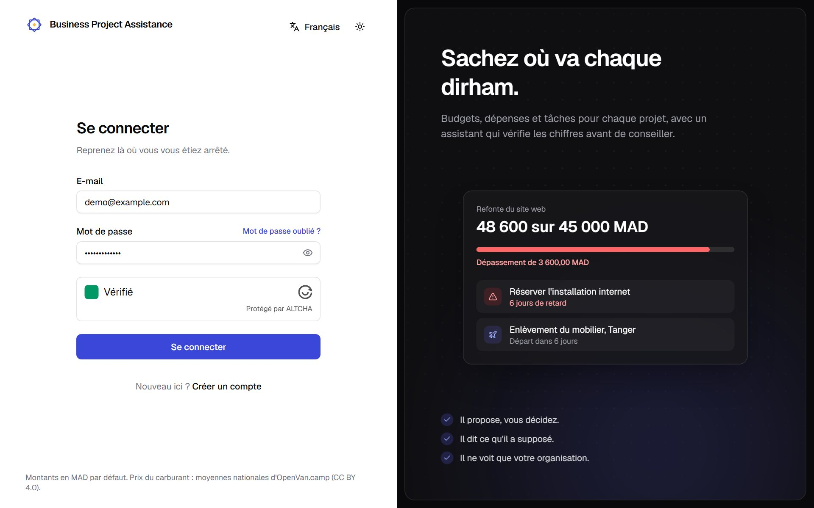<figcaption>Connexion avec la case « Je ne suis pas un robot » (captcha à preuve de travail)</figcaption></figure>

### Tableau de bord

Le tableau de bord rassemble les totaux de l'organisation (budget, dépensé, restant), les alertes (projets en
dépassement, tâches en retard), l'agenda des prochaines échéances et la liste des projets avec leur barre de
consommation du budget.

<figure class="shot">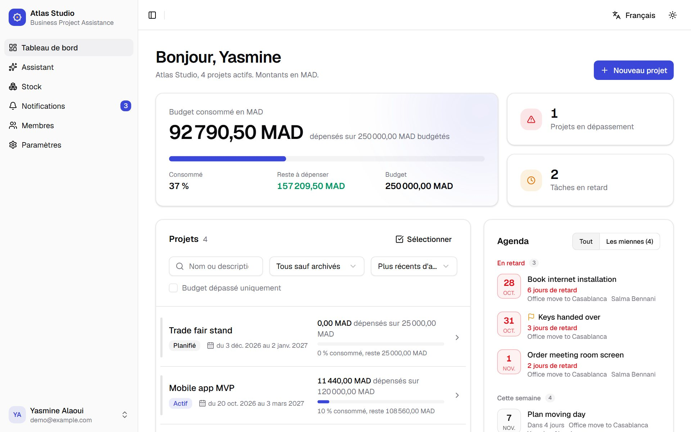<figcaption>Tableau de bord de l'organisation</figcaption></figure>

### Projet et rapport

La page d'un projet regroupe ses chiffres budgétaires, ses jalons, ses tâches, ses déplacements, ses dépenses,
son inventaire, le matériel utilisé et son journal d'activité. Le rapport présente la répartition des dépenses
et rappelle la définition de chaque chiffre.

<figure class="shot">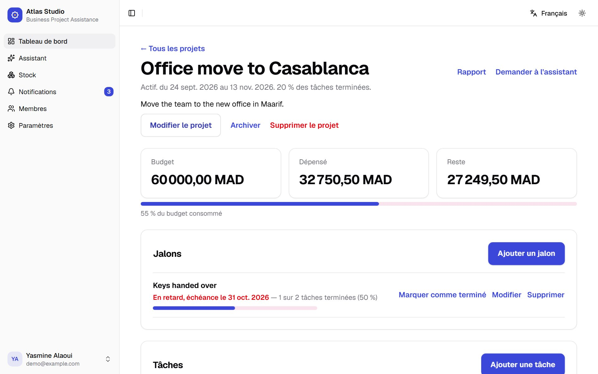<figcaption>Page d'un projet</figcaption></figure>

<figure class="shot">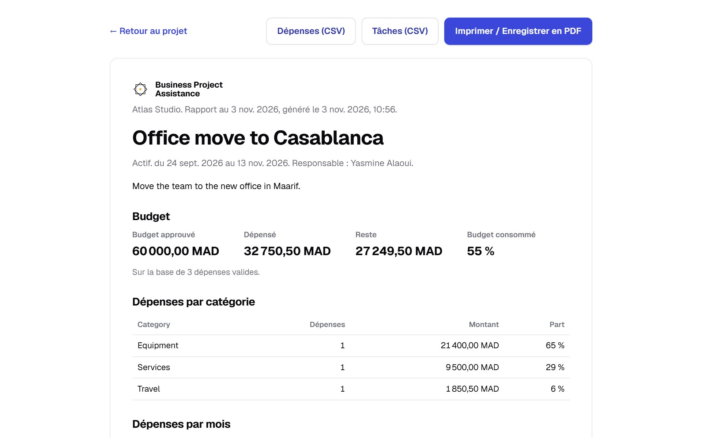<figcaption>Rapport d'un projet</figcaption></figure>

### Stock et entrepôts

<figure class="shot">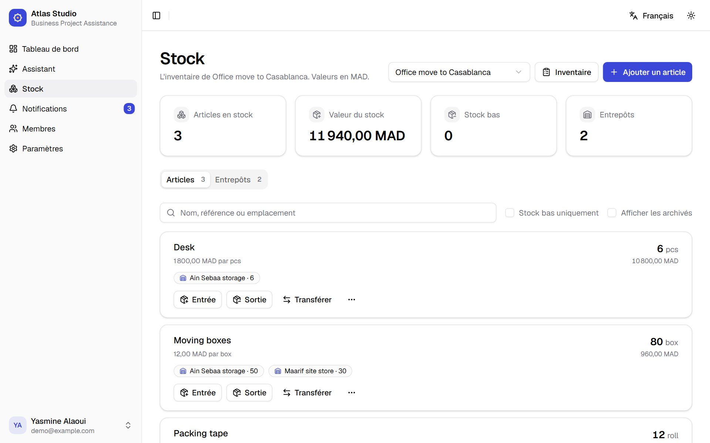<figcaption>Inventaire d'un projet, avec la répartition de chaque article par entrepôt</figcaption></figure>

<figure class="shot">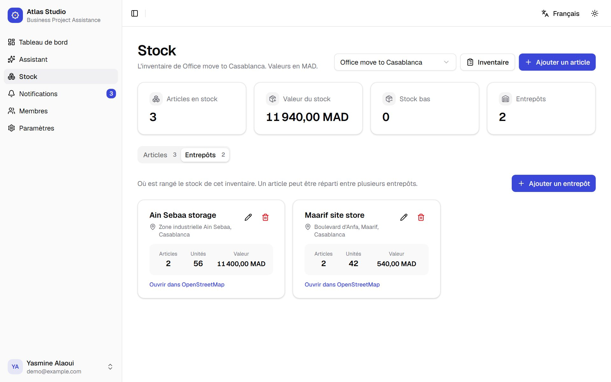<figcaption>Entrepôts d'un projet, avec adresse et contenu</figcaption></figure>

### Déplacements et carburant

<figure class="shot shot--narrow">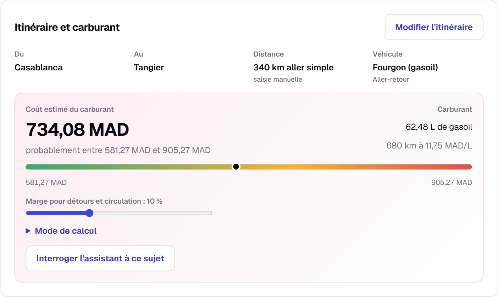<figcaption>Itinéraire d'un déplacement et estimation du coût du carburant</figcaption></figure>

<figure class="shot shot--narrow">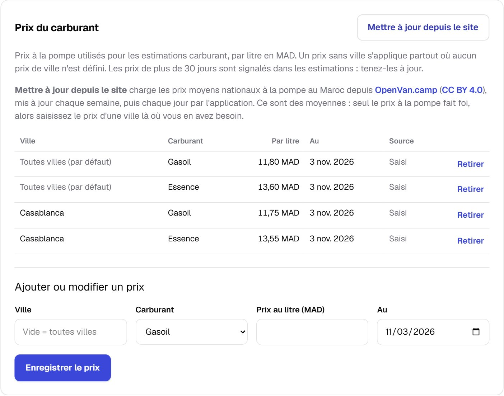<figcaption>Prix du carburant, mis à jour depuis OpenVan.camp</figcaption></figure>

### Assistant d'IA

Dans l'exemple ci-dessous, l'utilisateur pose deux questions dans le même message. L'assistant identifie le
projet en dépassement à partir des métriques du serveur et prépare l'entrée de stock, qui n'est enregistrée
qu'après confirmation.

<figure class="shot">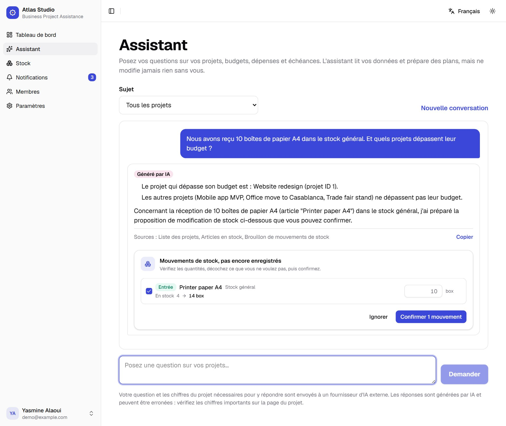<figcaption>Réponse de l'assistant et brouillon de mouvement de stock à confirmer</figcaption></figure>

### Membres, thème sombre et arabe

<figure class="shot">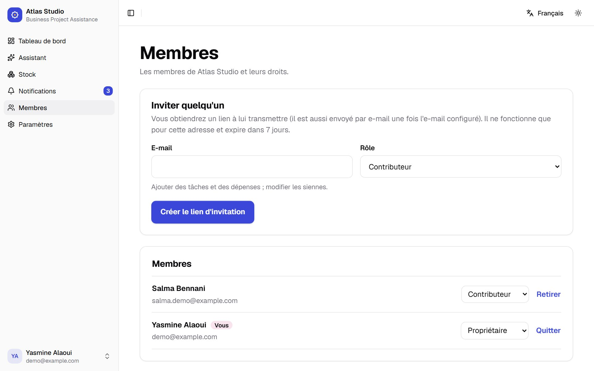<figcaption>Gestion des membres et des invitations</figcaption></figure>

<figure class="shot">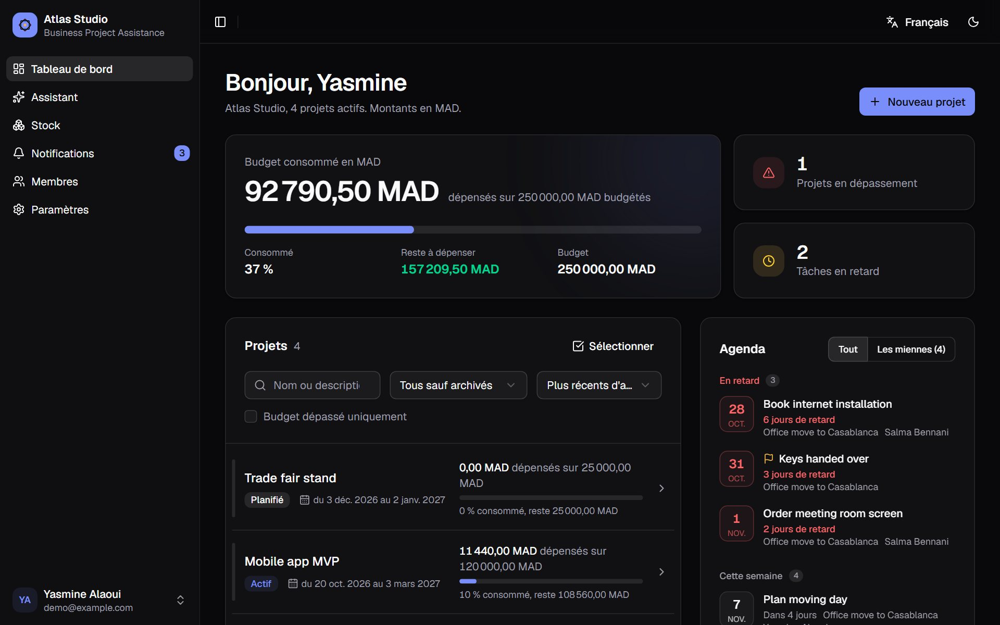<figcaption>Tableau de bord en mode sombre</figcaption></figure>

<figure class="shot">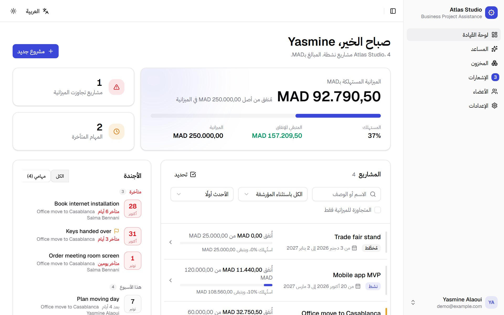<figcaption>Tableau de bord en arabe, avec une mise en page de droite à gauche</figcaption></figure>

## Tests et assurance qualité

La qualité a été vérifiée à plusieurs niveaux :

| Niveau | Outil | Contenu | Résultat |
| --- | --- | --- | --- |
| Tests du serveur | pytest | Métriques, permissions, API, stock, assistant (fournisseur simulé), captcha, migrations | 364 tests réussis |
| Bout en bout | Playwright | 15 parcours dans un vrai navigateur : connexion, tableau de bord, projet, justificatif, rapport, stock, entrepôts, déplacements, paramètres… | 15 étapes réussies |
| Assistant | `flask ai-eval` | 11 questions à réponse connue sur les données de démonstration | 11 / 11 |
| Visuel | Playwright | Captures en anglais, français et arabe, clair et sombre, ordinateur et téléphone | Sans débordement ni erreur |
| Dépendances | npm audit, pip-audit | Vulnérabilités connues des bibliothèques | Aucune |
| Base de données | Alembic sur PostgreSQL 16 | Application, retour arrière et vérification des migrations | Conforme |

Les tests de l'assistant n'appellent pas de vrai fournisseur : un fournisseur simulé rejoue des réponses
scriptées, ce qui permet de vérifier les permissions, le plafond de coût et la gestion des erreurs. L'évaluation
`ai-eval`, elle, interroge le vrai modèle et vérifie que les réponses contiennent les chiffres calculés par le
serveur au moment de l'exécution.

## Déploiement

L'application est conditionnée en trois conteneurs décrits dans `docker-compose.yml` :

- **db** : PostgreSQL 16, avec un contrôle de santé, accessible uniquement depuis la machine hôte ;
- **backend** : image Python 3.13, gunicorn, exécution sans privilèges, migrations appliquées au démarrage,
  justificatifs dans un volume ;
- **web** : nginx avec l'interface compilée, transmission de `/api`, en-têtes de sécurité, cache longue durée
  des fichiers versionnés, et aucune journalisation des adresses contenant un jeton d'invitation ou de
  réinitialisation.

La commande `docker compose up -d --build` démarre l'ensemble. Les paramètres sensibles sont lus dans un
fichier `.env` qui n'est jamais versionné ; une copie chiffrée (`.env.enc`, AES-256-GCM, clé dérivée d'une
phrase de passe par scrypt) peut être placée dans le dépôt pour faciliter l'installation sur un autre poste.

# Chapitre 5 : Aperçu technique approfondi / In-Depth Technical Overview

*This chapter gives a code-level explanation of the application, first in English and then in French,
complementing the functional description of the previous chapters. / Ce chapitre propose une explication
plus approfondie, au niveau du code, d'abord en anglais puis en français, en complément des chapitres
précédents.*

## 5.A — English version

### 5.A.1 Application architecture and request lifecycle

`backend/app/__init__.py` uses the application factory pattern: `create_app()` loads the configuration,
initialises SQLAlchemy, Flask-Migrate, Flask-JWT-Extended and CORS, optionally wraps the WSGI app in
`ProxyFix` (so rate limits see the real client IP behind a proxy), registers the `/api` blueprint and the CLI
commands, and installs JSON error handlers whose messages are translated from the `Accept-Language` header.

A typical request — a contributor adding an expense — flows as follows: the JWT decorator authenticates the
caller; the route parses and validates the JSON body (decimal amounts as strings, dates as ISO strings);
`get_membership()` loads the caller's active membership in the project's organization, raising 404 for
outsiders; `require_role()` raises 403 if the role is not allowed; the expense is saved with an audit entry, a
notification is sent if it tips the project over budget, and the response returns the expense together with the
project's recomputed figures, so the page can update without a second request.

### 5.A.2 Access control

Permissions are expressed as role tuples in `services/permissions.py` (`ORG_ADMIN_ROLES`,
`PROJECT_WRITE_ROLES`, `CONTRIBUTE_ROLES`) and checked explicitly at the start of each route. Ownership rules
complete the role checks: a contributor may edit only the expenses they created and change only the status of
tasks assigned to them. Returning 404 rather than 403 to non-members means that organization and project IDs
cannot be probed. The AI tools reuse exactly the same functions, so the assistant can never read more than the
user who asks.

### 5.A.3 Metrics engine

`services/metrics.py` contains pure functions over `Decimal` values, rounded half-up to two decimals: actual
spend (valid expenses only), remaining budget, variance, percentage consumed (`None`, shown as "N/A", when the
budget is zero), task completion (done ÷ non-cancelled tasks), overdue rules, spend rate, days until the
budget runs out, expense breakdowns, stock value, the haversine distance and the fuel estimate. The dashboard,
the project page, the report and the AI tools all call these functions, which is what guarantees that the
assistant quotes the same figures as the screens.

### 5.A.4 The AI tool loop

`services/ai_chat.py` builds a system prompt with the organization's context, the rules of the assistant and
the reply language, which the backend detects from the message (Arabic script, or common French and English
words). It then runs up to eight rounds: the provider returns tool calls, `ai_tools.run_tool()` validates the
arguments, executes the tool within the caller's permissions and returns JSON; the final round is sent without
tools so the model must answer. Usage (tokens, cost, status) is recorded in `ai_usage` without any prompt or
answer text. If the provider fails after a draft has been produced, the draft is still returned. Provider
adapters (`ai_provider.py`) hide the differences between Groq and Gemini, such as Gemini's thought signatures
that must be sent back unchanged and its nullable schema syntax.

### 5.A.5 Inventory ledger

Stock quantities change only through `services/stock.py`. Each operation — receive, issue, adjust, count,
transfer, move — validates the quantities available in the chosen warehouse, updates the item and its
per-warehouse rows, and appends an `InventoryMovement` with the quantity after the change. A move to another
inventory finds the matching item by name (or creates it, refusing a unit mismatch) and records a
`MOVE_OUT`/`MOVE_IN` pair. Drafts from the assistant are checked again when confirmed and applied all-or-nothing;
the error points at the failing line.

### 5.A.6 Security considerations and limitations

Passwords are hashed with Werkzeug; invitation and reset tokens are stored as SHA-256 hashes and shown only
once. Login is protected by per-IP and per-email limits and by a self-hosted ALTCHA proof-of-work captcha whose
solutions are valid once and for ten minutes. Uploaded files are checked by content, stored under random names
and served only to members. Known limitations, rather than oversights: rate-limit counters and used captcha
solutions live in memory, which assumes a single server process; HTTPS must be provided by a proxy in front of
the containers; the free tiers of the AI providers may use prompts to improve their products, which matters for
real customer data.

### 5.A.7 Suggested technical improvements

- Move rate limits and captcha state to a shared store (Redis) before running several server processes.
- Add revenue tracking and multi-currency reporting, excluded from the first version.
- Use city-level fuel prices when a reliable, licensed source becomes available.
- Add file storage in the cloud (S3-compatible) for receipts when hosting requires it.
- Extend the end-to-end tests to the Arabic interface and to mobile layouts.

## 5.B — Version française

### 5.B.1 Architecture de l'application et cycle de vie d'une requête

`backend/app/__init__.py` applique le patron « application factory » : `create_app()` charge la configuration,
initialise SQLAlchemy, Flask-Migrate, Flask-JWT-Extended et CORS, ajoute si nécessaire `ProxyFix` (pour que
les limites de débit voient l'adresse réelle du client derrière un proxy), enregistre le blueprint `/api` et les
commandes en ligne, et installe des gestionnaires d'erreurs JSON dont les messages sont traduits selon l'en-tête
`Accept-Language`.

Une requête typique — un contributeur qui ajoute une dépense — se déroule ainsi : le décorateur JWT
authentifie l'appelant ; la route lit et valide le corps JSON (montants décimaux en chaînes, dates au format
ISO) ; `get_membership()` charge l'adhésion active de l'appelant à l'organisation du projet et renvoie 404 aux
non-membres ; `require_role()` renvoie 403 si le rôle n'est pas autorisé ; la dépense est enregistrée avec une
entrée d'audit, une notification est envoyée si elle fait dépasser le budget, et la réponse renvoie la dépense ainsi que les
chiffres recalculés du projet, pour que la page se mette à jour sans seconde requête.

### 5.B.2 Contrôle d'accès

Les permissions sont exprimées sous forme de groupes de rôles dans `services/permissions.py`
(`ORG_ADMIN_ROLES`, `PROJECT_WRITE_ROLES`, `CONTRIBUTE_ROLES`) et vérifiées explicitement au début de chaque
route. Des règles de propriété complètent les rôles : un contributeur ne modifie que les dépenses qu'il a
créées et ne change que le statut des tâches qui lui sont assignées. Répondre 404 plutôt que 403 aux
non-membres empêche de sonder les identifiants d'organisations et de projets. Les outils de l'assistant
réutilisent exactement les mêmes fonctions : l'assistant ne peut jamais lire plus que l'utilisateur qui
l'interroge.

### 5.B.3 Moteur de métriques

`services/metrics.py` regroupe des fonctions pures sur des valeurs `Decimal`, arrondies au centime :
dépenses réelles (dépenses valides uniquement), budget restant, écart, pourcentage consommé (`None`, affiché
« N/A », quand le budget est nul), avancement des tâches (terminées ÷ non annulées), règles de retard, rythme
de dépense, nombre de jours avant épuisement du budget, répartitions, valeur du stock, distance orthodromique
et estimation du carburant. Le tableau de bord, la page projet, le rapport et les outils de l'IA appellent tous
ces fonctions : c'est ce qui garantit que l'assistant cite les mêmes chiffres que les écrans.

### 5.B.4 La boucle d'outils de l'assistant

`services/ai_chat.py` construit une consigne système avec le contexte de l'organisation, les règles de
l'assistant et la langue de réponse, que le serveur détecte dans le message (écriture arabe, ou mots courants du
français et de l'anglais). Il exécute ensuite jusqu'à huit tours : le fournisseur renvoie des appels d'outils,
`ai_tools.run_tool()` valide les arguments, exécute l'outil avec les droits de l'appelant et renvoie du JSON ;
le dernier tour est envoyé sans outils pour obliger le modèle à répondre. L'usage (jetons, coût, statut) est
enregistré dans `ai_usage` sans aucun texte de question ni de réponse. Si le fournisseur échoue après la
préparation d'un brouillon, celui-ci est tout de même renvoyé. Les adaptateurs (`ai_provider.py`) masquent les
différences entre Groq et Gemini, comme les signatures de raisonnement de Gemini, à renvoyer telles quelles, ou
sa syntaxe des schémas nullables.

### 5.B.5 Registre du stock

Les quantités ne changent que par `services/stock.py`. Chaque opération — entrée, sortie, ajustement,
inventaire, transfert, déplacement — vérifie les quantités disponibles dans l'entrepôt choisi, met à jour
l'article et ses lignes par entrepôt, et ajoute un `InventoryMovement` avec la quantité obtenue. Un déplacement
vers un autre inventaire retrouve l'article correspondant par son nom (ou le crée, en refusant une unité
différente) et enregistre une paire `MOVE_OUT`/`MOVE_IN`. Les brouillons de l'assistant sont revérifiés à la
confirmation et appliqués en tout ou rien ; l'erreur désigne la ligne en cause.

### 5.B.6 Considérations de sécurité et limites

Les mots de passe sont hachés avec Werkzeug ; les jetons d'invitation et de réinitialisation sont stockés sous
forme d'empreinte SHA-256 et ne sont montrés qu'une fois. La connexion est protégée par des limites par
adresse IP et par e-mail, et par un captcha à preuve de travail ALTCHA auto-hébergé, dont chaque solution n'est
valable qu'une fois et pendant dix minutes. Les fichiers envoyés sont contrôlés selon leur contenu, stockés sous
un nom aléatoire et servis uniquement aux membres. Limites connues, plutôt qu'oublis : les compteurs de débit et
les captchas utilisés sont gardés en mémoire, ce qui suppose un seul processus serveur ; le HTTPS doit être
assuré par un proxy placé devant les conteneurs ; les offres gratuites des fournisseurs d'IA peuvent utiliser
les questions pour améliorer leurs produits, ce qui compte pour de vraies données clients.

### 5.B.7 Pistes d'amélioration technique

- Déplacer les limites de débit et l'état du captcha vers un stockage partagé (Redis) avant de lancer plusieurs
  processus serveur.
- Ajouter le suivi des recettes et des rapports multidevises, exclus de la première version.
- Utiliser des prix du carburant par ville dès qu'une source fiable et sous licence sera disponible.
- Stocker les justificatifs dans un service de fichiers en nuage (compatible S3) si l'hébergement l'exige.
- Étendre les tests de bout en bout à l'interface arabe et aux écrans de téléphone.

# Conclusion générale

## Bilan du travail réalisé

Ce projet a permis de concevoir et de réaliser une application web complète de gestion de projets pour les
petites organisations, avec un contrôle d'accès à quatre rôles, des indicateurs budgétaires exacts et
documentés, la gestion des dépenses et de leurs justificatifs, un stock par projet réparti entre des entrepôts,
la planification de déplacements avec estimation du coût du carburant, et un assistant d'IA fiable qui
s'appuie sur les chiffres du serveur et ne modifie rien sans confirmation.

L'application atteint les objectifs fixés :

- organisations, rôles et invitations, avec un contrôle d'accès sur chaque route ;
- projets, jalons, tâches, dépenses, justificatifs, rapports et journal d'activité ;
- indicateurs budgétaires calculés en un seul endroit, en arithmétique décimale ;
- stock par projet et stock général, entrepôts sur carte, historique complet ;
- déplacements, itinéraires et estimation du carburant avec des prix mis à jour chaque jour ;
- assistant d'IA à 17 outils, avec brouillons confirmés par l'utilisateur ;
- interface en anglais, en français et en arabe, en modes clair et sombre ;
- 364 tests automatisés, un test de bout en bout et un conditionnement Docker.

## Difficultés rencontrées et solutions apportées

- **Limites des offres gratuites d'IA** : le palier gratuit de Groq limitait le nombre de jetons par minute, et
  une question complexe le dépassait. Solution : un fournisseur interchangeable (ajout de Gemini), un nombre de
  tours d'outils réglable, et la conservation des brouillons même si le fournisseur échoue en fin de réponse.
- **Langue des réponses** : un modèle léger répondait en français à des questions posées en anglais. Solution :
  le serveur détecte la langue du message et l'impose explicitement dans la consigne.
- **Source des prix du carburant** : le site utilisé au départ a changé de structure, et un autre site bloquait
  volontairement les accès automatisés. Solution : une recherche de sources, puis le choix d'une API publique,
  documentée et sous licence ouverte, plutôt que de contourner une protection.
- **Mise en page de droite à gauche** : certains composants (onglets, menus) restaient de gauche à droite en
  arabe. Solution : un fournisseur de direction appliqué à toute l'interface, vérifié par des captures.
- **Cohérence des chiffres** : éviter que l'interface, les rapports et l'assistant calculent différemment.
  Solution : un unique service de métriques, testé, utilisé partout.

[À compléter — difficultés personnelles ou organisationnelles rencontrées pendant le stage]

## Perspectives d'évolution

- Héberger l'application avec un nom de domaine, le HTTPS, des sauvegardes automatiques et des clés secrètes de
  production.
- Ajouter le suivi des recettes et la rentabilité par projet.
- Exporter les rapports et les listes au format Excel ou PDF.
- Envoyer des notifications par e-mail (dépassement de budget, stock bas, échéances).
- Proposer une application mobile hors ligne pour la saisie des dépenses sur le terrain.
- Utiliser des prix du carburant par ville et par marque lorsqu'une source fiable le permettra.

# Annexes et références

## Documentation officielle

- Flask — documentation officielle : https://flask.palletsprojects.com/
- SQLAlchemy — documentation officielle : https://docs.sqlalchemy.org/
- Alembic — documentation officielle : https://alembic.sqlalchemy.org/
- Flask-JWT-Extended — documentation officielle : https://flask-jwt-extended.readthedocs.io/
- React — documentation officielle : https://react.dev/
- Vite — documentation officielle : https://vite.dev/
- Tailwind CSS — documentation officielle : https://tailwindcss.com/docs
- shadcn/ui — documentation officielle : https://ui.shadcn.com/
- Leaflet — documentation officielle : https://leafletjs.com/
- OpenStreetMap, Nominatim et OSRM : https://www.openstreetmap.org/ · https://nominatim.org/ · https://project-osrm.org/
- Google Gemini API — compatibilité OpenAI : https://ai.google.dev/gemini-api/docs/openai
- Groq — documentation : https://console.groq.com/docs
- OpenVan.camp — API des prix du carburant : https://openvan.camp/en/developers
- ALTCHA — captcha à preuve de travail : https://altcha.org/
- Docker Compose — documentation officielle : https://docs.docker.com/compose/
- Playwright — documentation officielle : https://playwright.dev/
- Mermaid — diagrammes de ce rapport : https://mermaid.js.org/

## Documents du projet

- Cahier des charges : *AI Business Project Management — Cahier des charges* (document interne).
- Décisions approuvées : `DECISIONS.md` ; points ouverts : `docs/open-items.md`.
- Guide d'utilisation (anglais et français) : `docs/user-guide-en.pdf`, `docs/user-guide-fr.pdf`.
- Guide de déploiement : `docs/deployment.md`.

## Autres références

[À compléter — cours, ouvrages ou articles consultés dans le cadre du projet]
