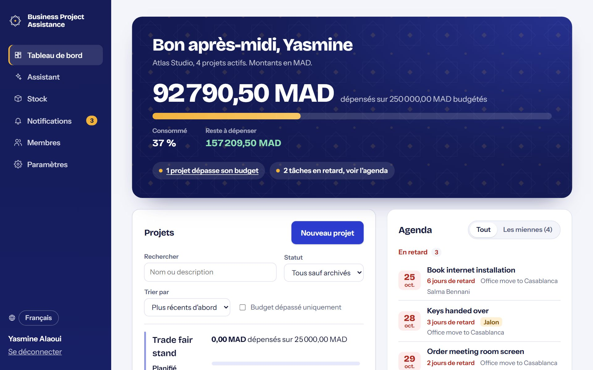
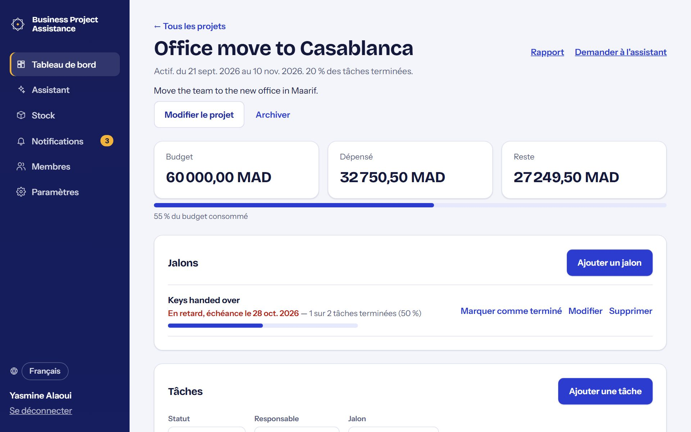
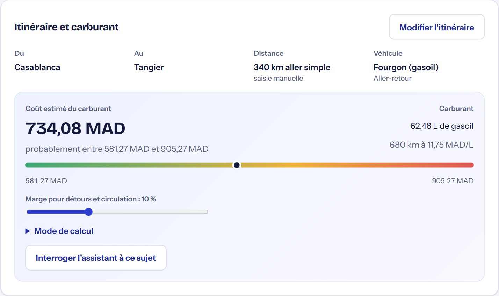
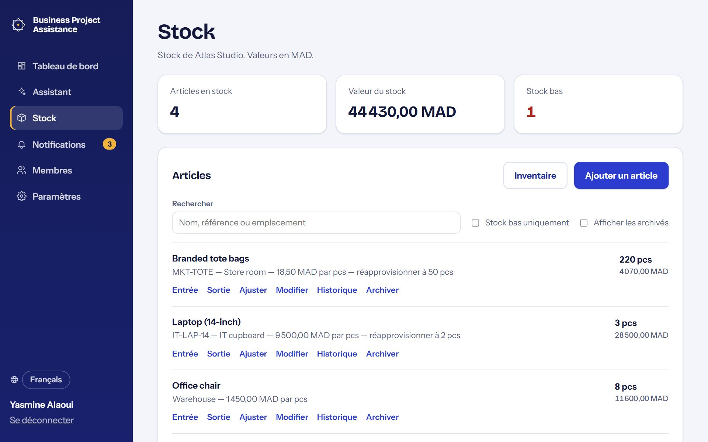
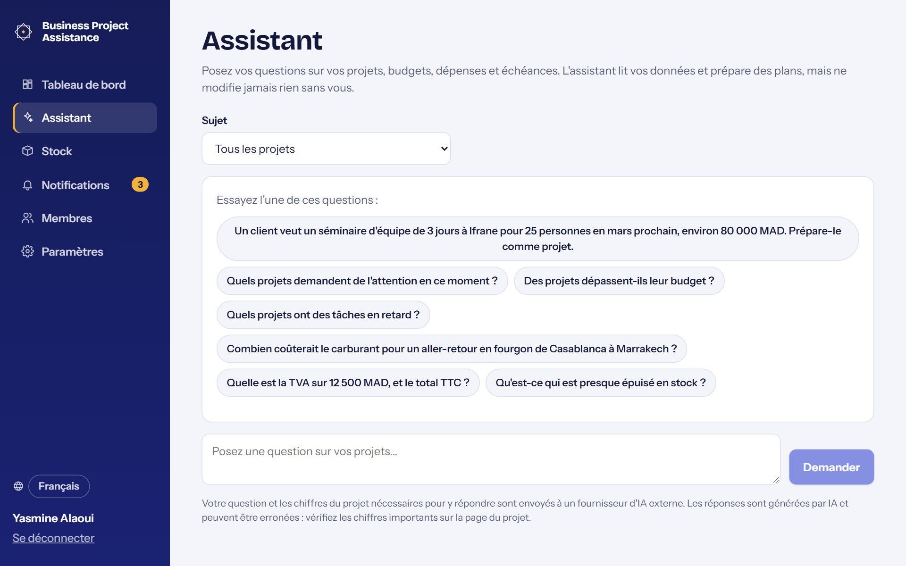

# Guide d'utilisation

BusinessProjectAssistance réunit vos projets, budgets, dépenses, tâches, déplacements et stock au même
endroit, avec un assistant qui répond à vos questions à leur sujet. Ce guide explique comment l'utiliser.

## Premiers pas

1. **Créez un compte** avec votre nom, votre e-mail et un mot de passe (au moins 8 caractères).
2. **Nommez votre organisation.** Tout se trouve dans une organisation : projets, personnes, stock. Vous en
   devenez le propriétaire. Les montants sont en dirhams marocains (MAD), sauf si vous choisissez une autre
   devise pour un projet.
3. **Invitez votre équipe** depuis **Membres** (voir plus bas), puis **créez votre premier projet** depuis le
   tableau de bord.

Vous avez reçu une invitation ? Ouvrez le lien reçu, créez un compte avec l'adresse e-mail à laquelle
l'invitation a été envoyée, puis sélectionnez **Rejoindre**.

Mot de passe oublié ? Sur la page de connexion, sélectionnez **Mot de passe oublié ?** et suivez le lien reçu.

## Qui peut faire quoi

| | Propriétaire | Chef de projet | Contributeur | Lecteur |
| --- | :-: | :-: | :-: | :-: |
| Voir les projets, rapports, l'activité et le stock | ✓ | ✓ | ✓ | ✓ |
| Interroger l'assistant | ✓ | ✓ | ✓ | ✓ |
| Ajouter des tâches et des dépenses | ✓ | ✓ | ✓ | |
| Modifier ses propres dépenses, le statut de ses tâches | ✓ | ✓ | ✓ | |
| Planifier des déplacements (et modifier les siens) | ✓ | ✓ | ✓ | |
| Enregistrer les entrées, sorties et inventaires | ✓ | ✓ | ✓ | |
| Créer, modifier, archiver des projets ; gérer les jalons | ✓ | ✓ | | |
| Modifier toute tâche, dépense ou déplacement | ✓ | ✓ | | |
| Gérer les articles en stock, ajuster le stock | ✓ | ✓ | | |
| Inviter, changer les rôles, retirer des membres | ✓ | | | |

## Le tableau de bord

Le tableau de bord présente, pour votre organisation :

- **La barre de budget** en haut : ce qui a été dépensé sur l'ensemble des budgets des projets actifs, avec le
  pourcentage consommé et le reste à dépenser.
- **Les alertes** en dessous : combien de projets dépassent leur budget (sélectionnez l'alerte pour les
  afficher) et combien de tâches sont en retard.
- **L'agenda** : le travail en retard, puis ce qui arrive aujourd'hui et demain, cette semaine et plus tard :
  tâches, jalons et départs en déplacement. Passez sur **Les miennes** pour ne voir que les tâches ouvertes
  qui vous sont assignées.
- **Les projets** : recherchez par nom ou description, filtrez par statut ou « Budget dépassé uniquement », et
  triez. Chaque projet affiche sa barre de budget, ses dates et ses tâches en retard ; un bord coloré signale
  les projets en dépassement (rouge) ou avec du travail en retard (jaune).

Si vous appartenez à plusieurs organisations, changez d'organisation en haut du menu de gauche.

## Projets

Ouvrez un projet depuis le tableau de bord. Un projet a un budget, des dates et un statut (planifié, actif,
en pause, terminé). Les propriétaires et chefs de projet peuvent **Modifier le projet** ou l'**Archiver**. Les
projets archivés sont en lecture seule et masqués du tableau de bord ; ouvrez-en un via le filtre de statut
et sélectionnez **Restaurer le projet**.

Les propriétaires de l'organisation peuvent aussi **supprimer** définitivement des projets, par exemple des projets
de test ou créés par erreur. Sur un projet, sélectionnez **Supprimer le projet**. Pour en supprimer plusieurs,
sélectionnez **Sélectionner** au-dessus de la liste, cochez les projets (la case à côté de « Projets » les
sélectionne tous), puis **Supprimer**. Réglez d'abord le filtre de statut sur « Archivé » pour faire le ménage
dans les projets archivés. La confirmation liste ce qui disparaîtra (dépenses, justificatifs, tâches, jalons,
déplacements) et vous demande de taper « supprimer ». C'est définitif. L'historique du stock est conservé : le
stock sorti pour un projet supprimé reste dans l'historique de l'article, avec le nom du projet.

### Budget et dépenses

- **Ajouter une dépense** : catégorie, montant, date, une note facultative et, le cas échéant, le
  déplacement concerné.
- **Dépensé** est la somme des dépenses valides. **Reste** est le budget moins le dépensé ; il devient négatif
  (en rouge) en cas de dépassement.
- Les dépenses ne sont jamais supprimées. En cas d'erreur, **Annulez**-la : elle reste enregistrée mais
  n'est plus comptée.
- Filtrez les dépenses par catégorie et par dates ; le total correspondant s'affiche sous les filtres.
- **Justificatifs** : sélectionnez **Ajouter un justificatif** sur une dépense pour joindre un PDF ou une
  photo (JPEG, PNG, WebP ; 10 Mo maximum, 10 fichiers par dépense). Toute personne qui voit le projet peut
  les consulter ; celle qui peut modifier la dépense peut en ajouter ou en retirer. Les justificatifs restent
  attachés aux dépenses annulées.

### Tâches et jalons

- **Ajouter une tâche** avec une priorité, une échéance, un responsable et, si besoin, un jalon.
- Une tâche est **en retard** quand elle n'est ni terminée ni annulée et que son échéance est passée.
- Les **jalons** sont des dates clés. Rattachez-y des tâches pour suivre l'avancement (« 3 sur 5 tâches
  terminées »). Sélectionnez **Marquer comme terminé** quand le jalon est atteint.
- Filtrez les tâches par statut, responsable (« Assignées à moi »), jalon ou retard.

### Déplacements

Planifiez les voyages d'affaires dans le projet concerné.

1. Sélectionnez **Planifier un déplacement** : titre, destination, dates et un budget facultatif.
2. Ouvrez le déplacement et **Ajoutez à l'itinéraire** : vols, trains, hôtels, réunions, avec les horaires
   (heure locale du lieu), les références de réservation et les coûts estimés.
3. Choisissez qui part sous **Voyageurs**.
4. Quand vous payez quelque chose, saisissez-le comme dépense sur le projet en choisissant le déplacement. La
   page du déplacement compare alors son **budget**, l'**estimation de l'itinéraire** et le **dépensé** réel.

**Imprimer l'itinéraire** produit une version propre pour les voyageurs.

#### Itinéraire et coût du carburant

Sur un déplacement, sélectionnez **Définir l'itinéraire** :

1. Indiquez le **départ** et l'**arrivée** : saisissez une ville ou une adresse et appuyez sur Entrée, ou
   cliquez sur la carte (le départ d'abord, puis l'arrivée). La distance routière provient de l'itinéraire
   tracé sur la carte. Si aucun itinéraire routier n'est trouvé, la distance est celle à vol d'oiseau × 1,3,
   signalée comme estimation. Vous pouvez aussi saisir la distance réelle.
2. Choisissez le **véhicule** (chacun a une fourchette de consommation habituelle), le nombre de véhicules,
   et s'il s'agit d'un aller-retour.

La page du déplacement affiche alors le **coût estimé du carburant** : un montant attendu et une fourchette
probable. La fourchette tient compte de la consommation du véhicule, de ±3 % sur le prix du carburant et
d'une distance supplémentaire pour les détours et la circulation (réglable avec le curseur). **Mode de
calcul** détaille chaque hypothèse, y compris la date du prix utilisé. Des alertes apparaissent quand le prix
date de plus de 30 jours ou que la distance est estimée.

Les prix du carburant viennent de **Paramètres → Prix du carburant**. Sélectionnez **Mettre à jour depuis le
site** pour charger les prix moyens du jour à la pompe (national et grandes villes) depuis
prix-gasoil-maroc.teraedge.ma, ou saisissez vous-même un prix pour une ville ou par défaut pour toutes les
villes. Ce sont des moyennes communautaires : seul le prix à la pompe fait foi.

### Activité

En bas de chaque projet, **Activité** liste chaque modification : qui a fait quoi, et quand.

### Rapport et exports

Sélectionnez **Rapport** sur un projet pour un résumé d'une page : budget, dépenses par catégorie et par
mois, tâches, jalons et mode de calcul de chaque chiffre. Utilisez **Imprimer / Enregistrer en PDF** pour le
partager, ou téléchargez les dépenses ou les tâches en fichiers **CSV** pour Excel.

### Faire préparer un projet par l'assistant

Décrivez la demande d'un client à l'assistant, par exemple : « Atlas Bank veut un séminaire d'équipe de
3 jours à Ifrane pour 25 personnes en mars prochain, environ 80 000 MAD. Prépare-le comme projet. » Il
répond avec un **projet brouillon** : nom, budget, dates, jalons et tâches, en précisant ce qu'il a supposé.
Ajustez le nom, le budget ou les dates, décochez ce que vous ne voulez pas, puis sélectionnez **Créer le
projet**. Rien n'est créé avant cela, et seuls les propriétaires et chefs de projet peuvent créer des
projets.

## Stock

**Stock**, dans le menu de gauche, suit ce que votre organisation garde en réserve.

- **Ajouter un article** : nom, unité (pièce, boîte, kg…), coût unitaire, seuil de réapprovisionnement et
  emplacement. Les articles au seuil ou en dessous sont marqués **Stock bas**.
- **Entrée** quand du stock arrive ; **Sortie** quand il est utilisé, éventuellement pour un projet (il
  apparaît alors sous **Matériel utilisé** sur ce projet). **Ajuster** corrige le stock en cas de casse ou de
  perte, avec un motif.
- **Inventaire** : comptez ce qui est en rayon et saisissez les quantités. Le stock prend les valeurs
  comptées, et les écarts sont affichés et enregistrés. Vous pouvez masquer les quantités attendues pendant
  le comptage.
- **Historique** montre chaque mouvement d'un article.

Le stock sorti pour un projet n'est pas ajouté à ses dépenses ; enregistrez les achats comme dépenses s'ils
doivent compter dans un budget.

Vous pouvez aussi dire à l'assistant ce qui s'est passé, par exemple « On a reçu 20 boîtes de papier et
2 chaises de bureau sont cassées ». Il prépare les mouvements de stock et affiche chacun avec la quantité avant
et après. Corrigez une quantité si besoin, décochez ce que vous ne voulez pas, puis sélectionnez **Confirmer**.
Rien ne change avant. La livraison d'un article que vous n'avez pas encore devient un nouvel article. Les règles
sont les mêmes que sur la page Stock : les contributeurs peuvent confirmer les entrées et les sorties ; la création
d'articles et les ajustements demandent un propriétaire ou un chef de projet.

## L'assistant

Sélectionnez **Assistant** (ou **Demander à l'assistant** sur un projet) et posez votre question en langage
courant, par exemple :

- « Quels projets demandent de l'attention en ce moment ? »
- « Sur quoi dépensons-nous le plus pour le déménagement ? »
- « Au rythme actuel, combien de temps le budget va-t-il durer ? »
- « Qu'est-ce qui est presque épuisé en stock ? »
- « Rédige un court point d'avancement que je peux partager. »
- « Quelle est la TVA sur 12 500 MAD ? » ou « Si nous dépensons 5 000 de plus, combien reste-t-il au
  budget ? »
- « Combien coûtera le carburant pour le déplacement Furniture pickup ? » ou « …pour un aller-retour en
  fourgon de Casablanca à Marrakech ? »

L'assistant **lit** vos données. Les seules modifications possibles sont des brouillons que vous confirmez : un
nouveau projet ou des mouvements de stock (voir Stock). Ses chiffres viennent des mêmes
calculs que le reste de l'application (il utilise une calculatrice plutôt que de compter lui-même), et il
signale les données manquantes. Les réponses sont marquées « Généré par IA » : vérifiez les chiffres
importants sur la page du projet. Votre question et les chiffres nécessaires pour y répondre sont envoyés à
un fournisseur d'IA externe. Il répond dans la langue de votre question.

## Notifications

**Notifications**, dans le menu de gauche, affiche le nombre d'éléments non lus. Vous êtes prévenu quand :

- une tâche vous est assignée,
- vous êtes ajouté comme voyageur à un déplacement,
- un projet dont vous êtes responsable dépasse son budget (les propriétaires de l'organisation aussi),
- un article en stock descend à son seuil de réapprovisionnement (propriétaires et chefs de projet),
- quelqu'un accepte une invitation que vous avez envoyée.

Vous n'êtes pas prévenu de vos propres modifications. Sélectionnez une notification pour y accéder
directement, ou **Tout marquer comme lu**.

## Membres

Les propriétaires gèrent les personnes sous **Membres** :

- **Inviter quelqu'un** avec son e-mail et un rôle. L'invitation lui est envoyée par e-mail, et vous obtenez
  aussi le lien pour le transmettre vous-même. Il ne fonctionne que pour cette adresse et expire après
  7 jours.
- Changez le rôle d'un membre dans la liste, ou **Retirez**-le. Chaque organisation garde au moins un
  propriétaire.
- Tout le monde peut **Quitter** une organisation.

## Langue

L'application est disponible en français, en anglais et en arabe (les pages en arabe se lisent de droite à
gauche). Choisissez la langue avec le menu à globe en bas du menu de gauche (ou en haut des pages de
connexion et d'inscription). Votre choix est mémorisé sur cet appareil et sur votre compte : les e-mails de
réinitialisation et les notifications arrivent dans la même langue.

## Bon à savoir

- Votre connexion dure 12 heures. Ensuite, on vous demande de vous reconnecter et vous revenez là où vous
  étiez.
- Après plusieurs mots de passe erronés, la connexion est suspendue quelques minutes.
- Les montants sont toujours affichés avec leur devise. Un projet utilise une seule devise.
