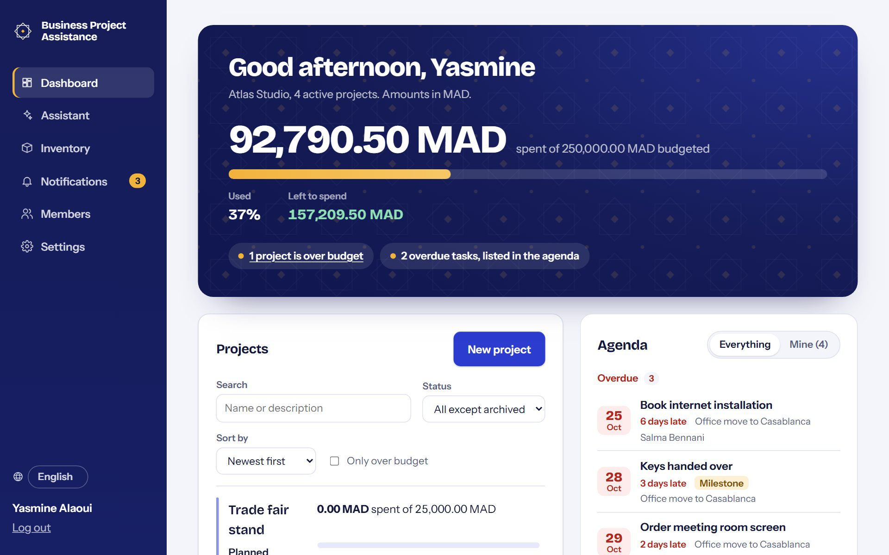
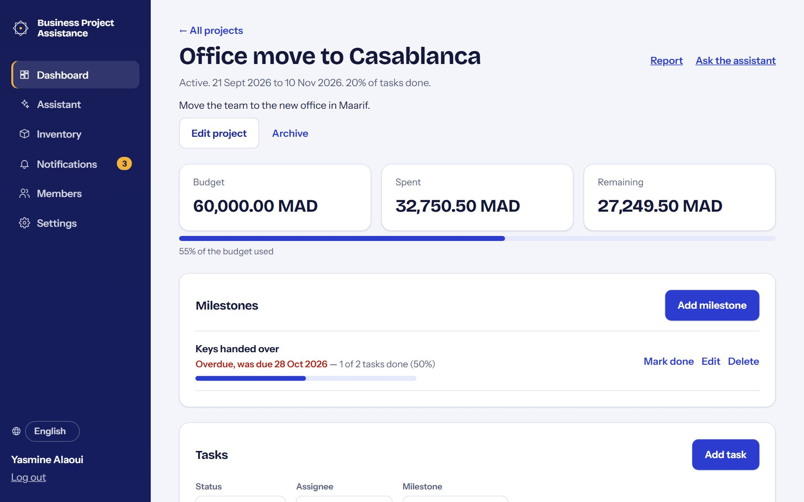
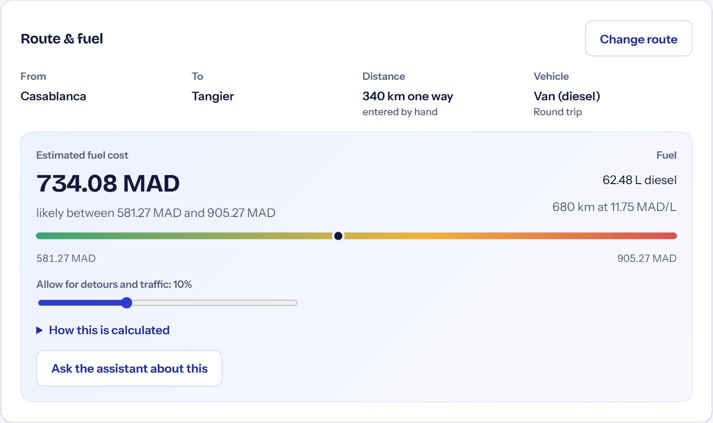
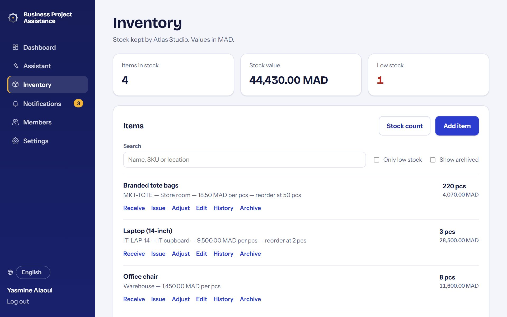
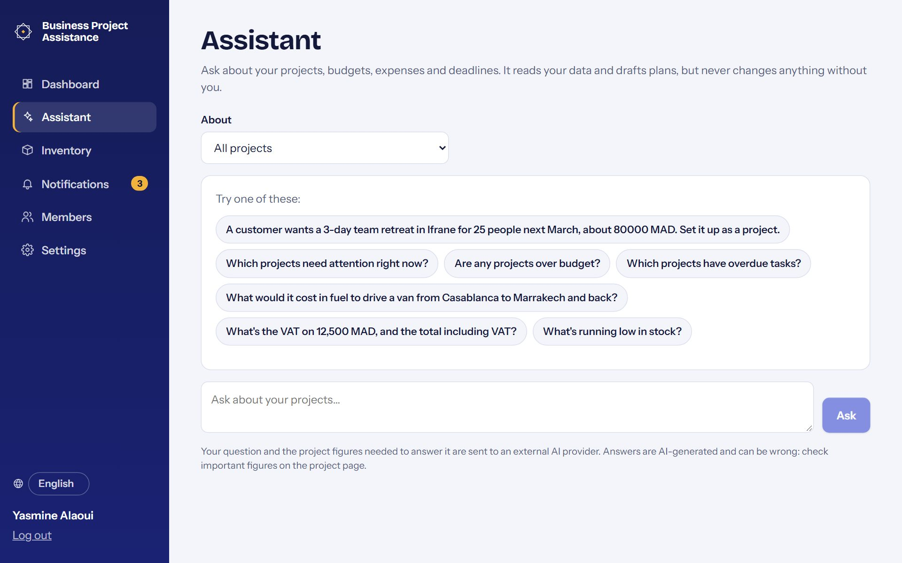

# User guide

BusinessProjectAssistance keeps your projects, budgets, spending, tasks, trips and stock in one place,
and has an assistant that answers questions about them. This guide explains how to use it.

## Getting started

1. **Create an account** with your name, email and a password (at least 8 characters).
2. **Name your organization.** Everything lives inside an organization: projects, people, stock. You become
   its owner. Amounts are in Moroccan dirham (MAD) unless you choose another currency for a project.
3. **Invite your team** from **Members** (see below), then **create your first project** from the dashboard.

Joined through an invite? Open the link you were sent, create an account with the same email address the
invite was sent to, and select **Join**.

Forgot your password? On the login page select **Forgot your password?** and follow the link you receive.

## Who can do what

| | Owner | Project manager | Contributor | Viewer |
| --- | :-: | :-: | :-: | :-: |
| See projects, reports, activity, stock | ✓ | ✓ | ✓ | ✓ |
| Ask the assistant | ✓ | ✓ | ✓ | ✓ |
| Add tasks and expenses | ✓ | ✓ | ✓ | |
| Change own expenses, status of own tasks | ✓ | ✓ | ✓ | |
| Plan trips (and change their own) | ✓ | ✓ | ✓ | |
| Receive, issue and count stock | ✓ | ✓ | ✓ | |
| Create, edit, archive projects; manage milestones | ✓ | ✓ | | |
| Edit any task, expense or trip | ✓ | ✓ | | |
| Manage stock items, adjust stock | ✓ | ✓ | | |
| Invite people, change roles, remove members | ✓ | | | |

## The dashboard

The dashboard shows, for your organization:

- **The budget bar** at the top: how much has been spent of everything budgeted across active projects, with
  the percentage used and what's left to spend.
- **Warnings** under it: how many projects are over budget (select it to list them) and how many tasks are
  overdue.
- **Agenda**: overdue work, then what's due today and tomorrow, this week and later: tasks, milestones and
  trips leaving. Switch to **Mine** to see only the open tasks assigned to you.
- **Projects**: search by name or description, filter by status or "Only over budget", and sort. Each project
  shows its budget bar, dates and overdue tasks; a coloured edge marks projects over budget (red) or with
  overdue work (yellow).

If you belong to more than one organization, switch between them at the top of the left-hand menu.

## Projects

Open a project from the dashboard. A project has a budget, dates and a status (planned, active, on hold,
completed). Owners and project managers can **Edit project** or **Archive** it. Archived projects are
read-only and hidden from the dashboard; open one through the status filter and select **Restore project**.

Organization owners can also **delete** projects for good, for example test projects or ones created by mistake.
On a project, select **Delete project**. To delete several at once, select **Select** above the project list,
tick the projects (the checkbox next to "Projects" selects all of them), then **Delete**. Set the status filter
to "Archived" first to clear out archived projects. The confirmation lists what will go (expenses, receipts,
tasks, milestones, trips) and asks you to type "delete". It can't be undone. Stock history is kept: stock
issued to a deleted project stays in the item's history, marked with the project's name.

### Budget and expenses

- **Add expense**: category, amount, date, an optional note and, if relevant, the trip it was for.
- **Spent** is the sum of valid expenses. **Remaining** is budget minus spent; it goes negative (red) when
  you're over budget.
- Expenses are never deleted. If one was a mistake, **Void** it: it stays on record but stops counting.
- Filter expenses by category and dates; the total for the filter is shown under the filters.
- **Receipts**: select **Add receipt** on an expense to attach a PDF or photo (JPEG, PNG, WebP; up to 10 MB,
  10 files per expense). Anyone who can see the project can view them; whoever can edit the expense can add
  or remove them. Receipts stay with voided expenses.

### Tasks and milestones

- **Add task** with a priority, due date, assignee and, optionally, a milestone.
- A task is **overdue** when it isn't done or cancelled and its due date has passed.
- **Milestones** are key dates. Link tasks to them to see progress ("3 of 5 tasks done"). Select
  **Mark done** when the milestone is reached.
- Filter tasks by status, assignee ("Assigned to me"), milestone or overdue.

### Trips

Plan business travel under the project it's for.

1. Select **Plan a trip**: title, destination, dates and an optional budget.
2. Open the trip and **Add to itinerary**: flights, trains, hotels, meetings, with times (local to where they
   happen), booking references and estimated costs.
3. Choose who's going under **Travelers**.
4. When you pay for something, record it as an expense on the project and choose the trip. The trip page then
   compares its **budget**, the **itinerary estimate** and what was actually **spent**.

**Print itinerary** gives a clean copy for the travelers.

#### Route and fuel cost

On a trip, select **Set route**:

1. Choose where the trip **starts** and **ends**: type a city or address and press Enter, or click the map
   (start first, then finish). The road distance comes from the route drawn on the map. If no road route is
   found, the distance is the straight line × 1.3, marked as an estimate. You can also type the real distance.
2. Choose the **vehicle** (each has a typical fuel consumption range), how many vehicles, and whether it's a
   round trip.

The trip page then shows the **estimated fuel cost**: an expected figure and a likely range. The range
allows for the vehicle's consumption range, ±3% on the fuel price, and extra distance for detours and
traffic (adjust it with the slider). **How this is calculated** lists every assumption, including the date
of the fuel price used. Warnings appear when the price is more than 30 days old or the distance is an
estimate.

Fuel prices come from **Settings → Fuel prices**. Select **Update from website** to load today's average
pump prices (national and main cities) from prix-gasoil-maroc.teraedge.ma, or enter a price yourself for a
city or as the default for any city. Prices are community-reported averages; the pump price is what counts.

### Activity

At the bottom of each project, **Activity** lists every change: who did what, and when.

### Report and exports

Select **Report** on a project for a one-page summary: budget, spending by category and month, tasks,
milestones and how each figure is calculated. Use **Print / Save as PDF** to share it, or download the
expenses or tasks as **CSV** files for Excel.

### Let the assistant draft a project

Describe a customer's request to the assistant, for example: "Atlas Bank wants a 3-day team retreat in
Ifrane for 25 people next March, about 80,000 MAD. Set it up as a project." It replies with a **draft
project**: name, budget, dates, milestones and tasks, and says what it assumed. Adjust the name, budget or
dates, untick anything you don't want, then select **Create project**. Nothing is created until you do,
and only owners and project managers can create projects.

## Inventory

**Inventory** in the left-hand menu tracks what your organization keeps in stock.

- **Add item**: name, unit (pcs, box, kg…), unit cost, a reorder level and where it's kept. Items at or below
  their reorder level are marked **Low stock**.
- **Receive** when stock arrives; **Issue** when it's used, optionally for a project (it then appears under
  **Materials used** on that project). **Adjust** corrects stock for damage or loss, with a reason.
- **Stock count**: count what's on the shelves and enter the numbers. Quantities are set to what you counted
  and the differences are shown and recorded. You can hide the expected quantities while counting.
- **History** shows every change to an item.

Stock issued to a project isn't added to the project's spending; record purchases as expenses if they
should count against a budget.

You can also tell the assistant what happened, for example "We received 20 boxes of printer paper and
2 office chairs broke". It drafts the stock changes and shows each one with the quantity before and after.
Correct any quantity, untick what you don't want, and select **Confirm**. Nothing changes until you do.
Deliveries of something you don't stock yet become a new item. The same rules apply as on the Stock page:
contributors can confirm receipts and issues; adding items and adjustments need an owner or project manager.

## The assistant

Select **Assistant** (or **Ask the assistant** on a project) and ask in plain language, for example:

- "Which projects need attention right now?"
- "What are we spending the most on in the office move?"
- "At the current spend rate, how long will the budget last?"
- "What's running low in stock?"
- "Draft a short status update I can share."
- "What's the VAT on 12500 MAD?" or "If we spend 5000 more, how much budget is left?"
- "How much will fuel cost for the Furniture pickup trip?" or "…to drive a van from Casablanca to Marrakech
  and back?"

The assistant **reads** your data. The only changes it can make are drafts you confirm: a new project, or stock
changes (see Stock). Its figures come from the same
calculations as the rest of the app (it uses a calculator tool rather than doing sums itself), and it says when data is missing. Answers are marked "AI-generated":
check important figures on the project page. Your question and the figures needed to answer it are sent to
an external AI provider.

## Notifications

**Notifications** in the left-hand menu shows a count of unread items. You're told when:

- a task is assigned to you,
- you're added as a traveler on a trip,
- a project you own goes over budget (organization owners are told too),
- a stock item drops to its reorder level (owners and project managers),
- someone accepts an invite you sent.

You aren't notified about your own changes. Select a notification to go straight to it, or
**Mark all as read**.

## Members

Owners manage people under **Members**:

- **Invite someone** with their email and a role. The invite is emailed to them, and you also get the link
  to send yourself. It works only for that email address and expires after 7 days.
- Change a member's role from the list, or **Remove** them. Every organization keeps at least one owner.
- Anyone can **Leave** an organization.

## Language

The app is available in English, French and Arabic (Arabic pages read right to left). Pick a language with the globe menu at the bottom of the sidebar
(or at the top of the login and sign-up pages). Your choice is remembered on this device and on your account,
so password-reset emails and notifications arrive in the same language. The assistant answers in the language
you write in.

## Good to know

- Your login lasts 12 hours. After that, you're asked to log in again and taken back to where you were.
- After several wrong passwords, logging in is paused for a few minutes.
- Amounts are always shown with their currency. One project uses one currency.
